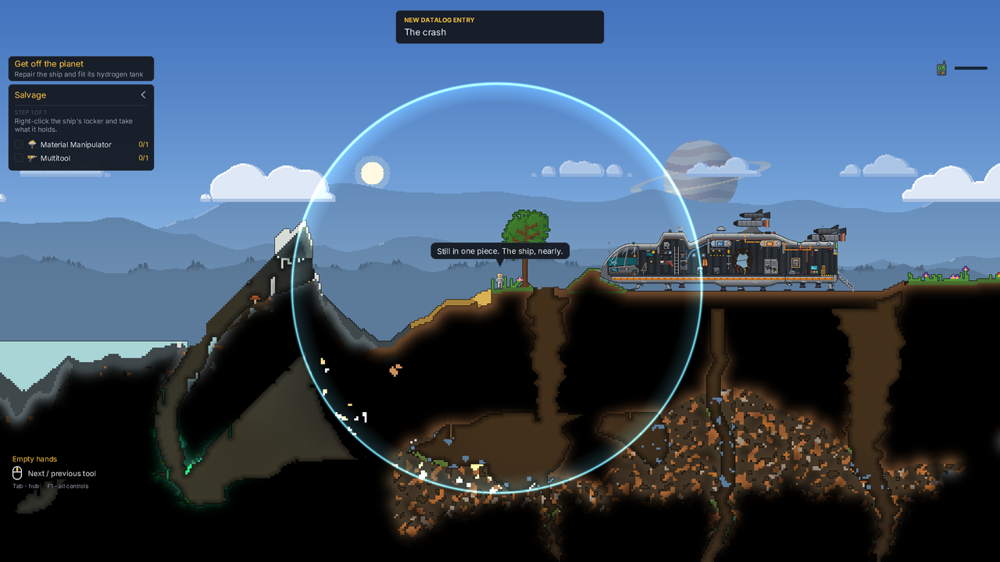
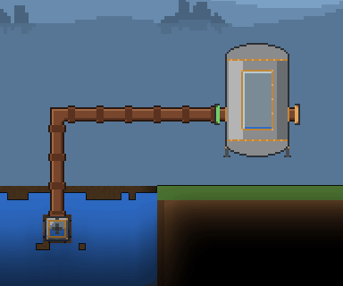
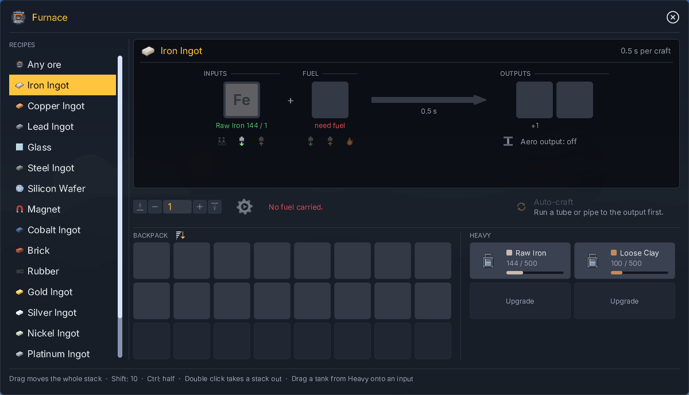
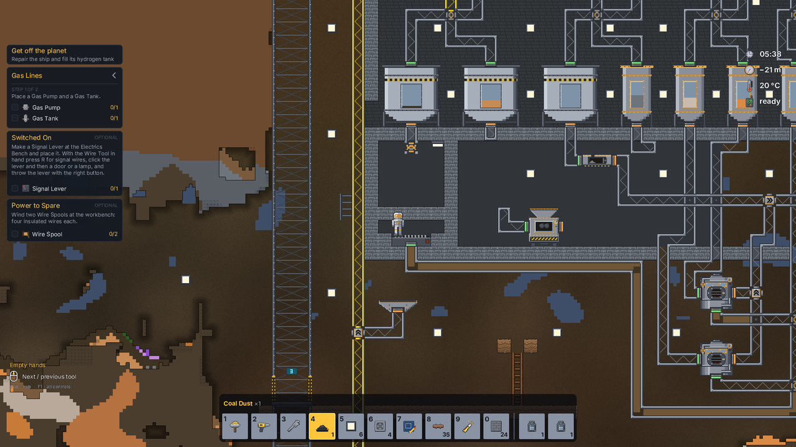
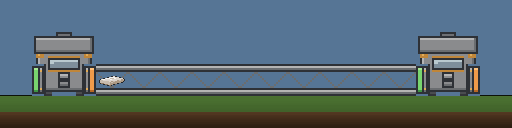

# SandboxIt

**A 2D sandbox survival game where the whole world is simulated matter** - Terraria meets Noita.

Every pixel of the world is a material that behaves: sand falls and piles, water runs and finds its level, lava
cools to stone, fire spreads and smoke rises, and every cell has a temperature. You are an engineer stranded on a
strange planet after your ship came down. Everything you build is made of what you dig - first a clay furnace, then
metal, machines and the pipes and tubes between them - and every machine is one step closer to home.

**[Download for Windows](https://github.com/bice4/psandboxit/releases/latest)** ·
**[Read the wiki](https://bice4.github.io/psandboxit/wiki/)**

## Matter is real

Nothing in the world is scenery. Dig a hole under a lake and the lake drains into it; light a coal seam and it
burns for real; pour water on lava and you get steam and stone. Liquids and gases are pumped through pipes, held in
tanks and carried in canisters, and what you collect is the same matter you will pour out again.

- sand, earth, clay, ores, wood, glass, concrete and dozens more, each with its own weight, hardness and heat
- water, oil, brine, lava; steam, smoke, hydrogen, methane
- reactions on contact and with heat: things soak, dissolve, freeze, melt, boil, ignite and explode

 

## Build from what you dig

One tree of stations and recipes takes you from a clay furnace to steel, electronics and oil. Quests walk the way
and say why each machine matters; a datalog keeps what you have learned, and a scanner shows where the ore lies.
Stations are fed by hand at first, then by tubes and pipes, and some run on their own once connected.

 

## A base that runs itself

Aero tubes carry items and loose matter from station to station; pipes carry liquids and gases. Power, signals,
drones, a drill rig and a lift turn a camp into a plant that keeps working while you are away.

## A world, and a way home

- generated worlds in three sizes, with biomes on the surface and underground, caves, lakes and a lava floor
- plants that grow, burn and fall; day and night; a ruin in the desert with a story in it
- a crashed ship to repair, corporations to trade and take contracts with, and a passage off the planet

SandboxIt is in development and runs on Windows (64-bit). Each release says what is new and what is still rough.

## Download

**[Get the latest build](https://github.com/bice4/psandboxit/releases/latest)** - a zip. Unpack it somewhere you
can write to (not Program Files: saves and logs are kept beside the game) and run `SandboxIt.exe`. `checksums.txt`
beside the zip holds its SHA-256.

## The wiki

**[Open the SandboxIt Wiki](https://bice4.github.io/psandboxit/wiki/)** - every material, item, station, recipe and
machine in the game, with the game's own pictures: how things are made and what they are for.

## About this repository

This repository holds the published wiki and the game's builds, not its source. It is generated from the game's private repository by
`tools/wiki/publish.py` - **do not edit it here**: every publish replaces it whole.

Last published from commit `1c49f1fc` on 2026-10-15.
