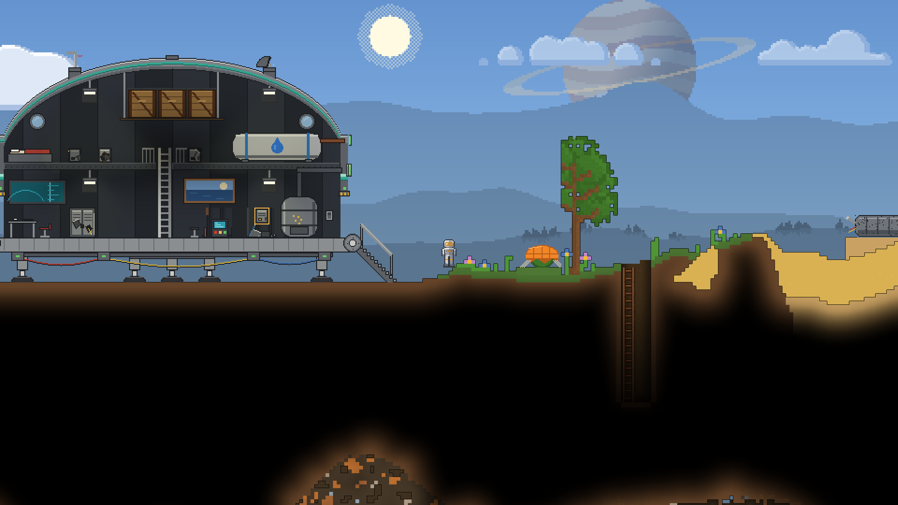
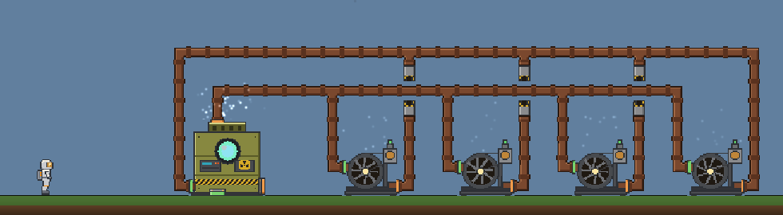

# SandboxIt

**A 2D sandbox where the whole world is simulated matter** - Terraria meets Noita, on a plot of a moon you hold a licence to.

Every pixel of the world is a material that behaves: sand falls and piles, water runs and finds its level, lava cools
to stone, fire spreads and smoke rises, and every cell has a temperature. You are a settler who bought the right to
a plot of the fourth moon of a ringed gas giant. Your capsule broke as it came down and will never fly again; you start with its
lockers and what is left of your savings. Everything you build is made of what you dig - first a clay furnace, then
metal, machines and the pipes and tubes between them - until the corporations of the system answer your calls and
your plot is a business of your own.

**[Download for Windows](https://github.com/bice4/psandboxit/releases/latest)** ·
**[Read the wiki](https://bice4.github.io/psandboxit/wiki/)** ·
**[Вікі українською](https://bice4.github.io/psandboxit/wiki/uk/)**

**In English and Ukrainian** - the game and its wiki both.

## Matter is real

Nothing in the world is scenery. Dig a hole under a lake and the lake drains into it; light a coal seam and it
burns for real; pour water on lava and you get steam and stone. Liquids and gases are pumped through pipes, held in
tanks and carried in canisters, and what you collect is the same matter you will pour out again.

- sand, earth, clay, ores, wood, glass, concrete and dozens more, each with its own weight, hardness and heat
- water, oil, brine, lava; steam, smoke, hydrogen, methane
- reactions on contact and with heat: things soak, dissolve, freeze, melt, boil, ignite and explode
- richer ground at the heart of a vein and deep down, which pays out more at a station

 

## Build from what you dig

One tree of stations and recipes takes you from a clay furnace to steel, electronics, oil and uranium. Quests walk
the way and say why each machine matters, and a datalog keeps what you have learned. Stations are fed by hand at
first, then by tubes and pipes, and run on their own once connected.

 

## A base that runs itself

Aero tubes carry items and loose matter from station to station; pipes carry liquids and gases. Wind, steam and in
time a reactor give the power; signals, drones, a drill rig and a lift turn a camp into a plant that keeps working
while you are away.

## Living off the land

Lay garden beds and keep them watered, lit and warm; sow trees from seed; keep bees. A harvest is milled, brewed and
packed into crates the traders buy, and the weather - rain, snow, sandstorms - comes and goes by biome.

## A settler's business

Repair the capsule's antenna and the system's five corporations hear you: call a trader down to your landing pad,
take contracts, talk, and win their regard - or lose it. Buy the licences the government sells, one after another,
fly up to the orbital station to trade at its market, and in time found a corporation of your own, with its name,
its emblem and its flag. The game has no ending: the plot is yours to work.

## Frontier, if you want it

Switch Frontier on when you make a world and the moon can kill you: falls, lava, cold, gas, drowning, blasts and
radiation; a suit to keep charged and mended; a death that drops your things in a bag where you fell. Pirate lairs
among the asteroids fight back.

 

## A world

- generated worlds in three sizes, with biomes on the surface and underground, caves, lakes and a lava floor
- plants that grow, burn and fall; day and night under a ringed giant; meteor showers and cave-ins
- the wreck of your descent to take apart, ruins with a story in them, and asteroids to fly out to

SandboxIt is in development and runs on Windows (64-bit). Each release says what is new and what is still rough.

## Languages · Download · The wiki

*(unchanged from today's README)*
